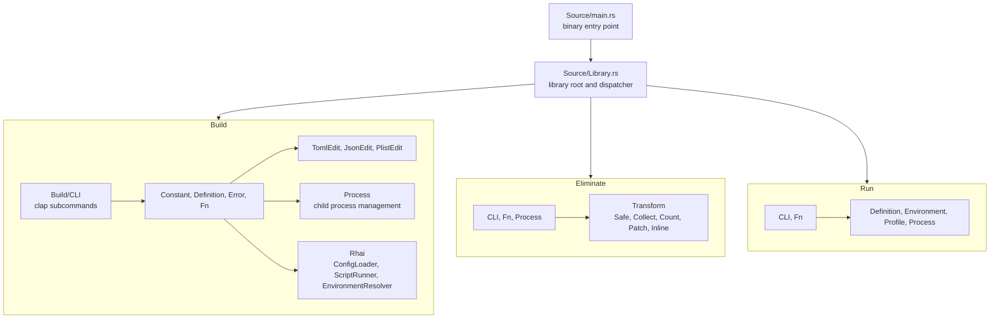
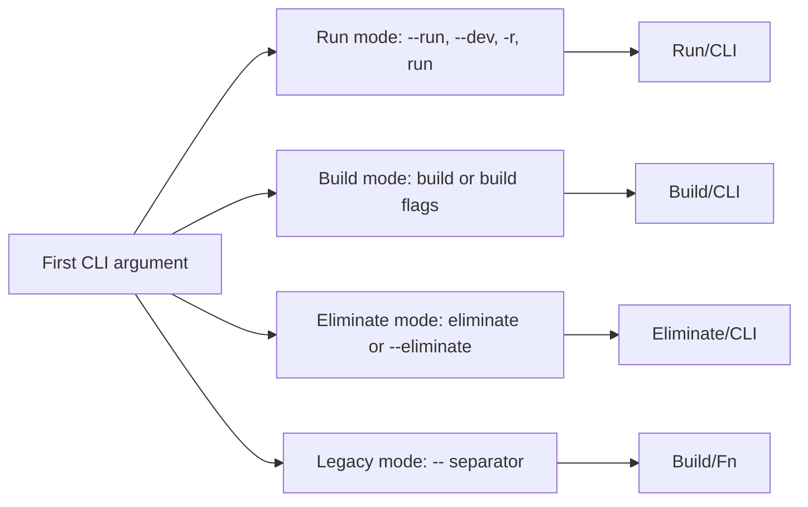
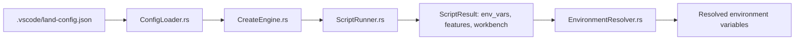
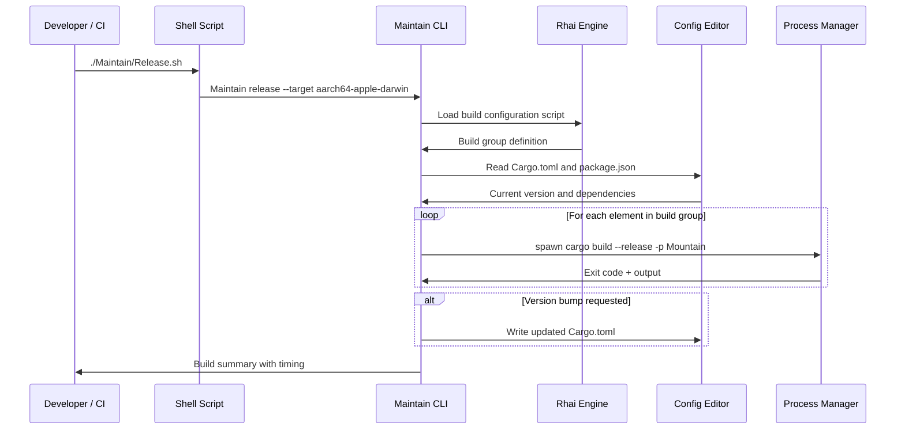
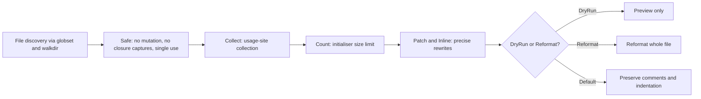
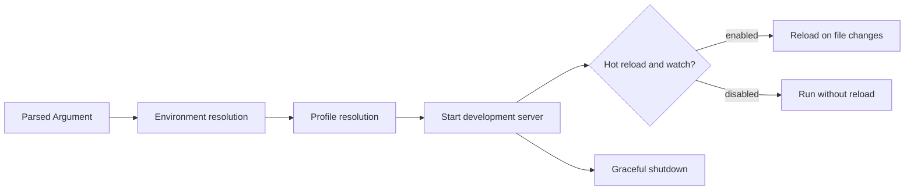

<table>
	<tr>
		<td colspan="1">
			<h3 align="center">
				<picture>
					<source media="(prefers-color-scheme: dark)" srcset="https://editor.land/Dark/Image/GitHub/Land.svg">
					<source media="(prefers-color-scheme: light)" srcset="https://editor.land/Image/GitHub/Land.svg">
					
				</picture>
			</h3>
		</td>
		<td colspan="3" valign="top"><h3 align="center">Maintain</h3></td>
	</tr>
</table>

---

# **Maintain** Architecture

`Maintain` is the `Rust` build system and CI/CD toolkit for `Land`. It orchestrates builds across all Land elements, embeds a `Rhai` scripting engine for flexible automation, and provides type-safe `TOML`/`JSON5` configuration editing.

---

## Overview 📋

| Component | Description | Implementation |
| --------- | ----------- | -------------- |
| `CLI` | Subcommand dispatcher | `clap` derive macros |
| `Build` | Cross-element build orchestration | `cargo` integration |
| `Script` | `Rhai` scripting engine | Embedded `rhai` runtime |
| `Config` | Type-safe config editing | `toml_edit` / `json5` |
| `Eliminate` | `AST` dead-code elimination | `syn` / `prettyplease` |
| `Run` | Development runner | Profile-based process management |
| `Architecture` | Platform detection and target triples | `TargetArchitecture` |

`Maintain` is a `Rust` binary and library. The CLI layer accepts subcommands and delegates to the `Rhai` scripting engine or direct build functions. Configuration editing is performed through `toml_edit` and `json5` for structured, non-lossy modifications to project configuration files.

---

## Architecture 🏗️



The binary entry point `Source/main.rs` delegates to `Maintain::main` in `Source/Library.rs`. `Source/Library.rs` dispatches to four top-level modules: `Build`, `Run`, `Eliminate`, and `Architecture`.

---

## Module Structure 🗺️

| Path | Description |
| ---- | ----------- |
| `Source/Library.rs` | Binary entry point; wires together CLI, logging, and error handling |
| `Source/Build/CLI.rs` | `clap`-based CLI with subcommands: build, list-profiles, show-profile, validate-profile, resolve |
| `Source/Build/CLI/Cli.rs` | Command-line interface with `clap` (subcommands: build, list-profiles, show-profile, validate-profile, resolve) |
| `Source/Build/CLI/Commands.rs` | Subcommand enum definitions |
| `Source/Build/CLI/GetAllProfiles.rs` | Sorted profile name listing |
| `Source/Build/CLI/OutputFormat.rs` | Output format values: table, json, env |
| `Source/Build/Constant.rs` | File paths, delimiters, and environment variable names |
| `Source/Build/Definition.rs` | Build group definitions: which elements to build, in what order |
| `Source/Build/Error.rs` | Unified error type for build failures |
| `Source/Build/Fn.rs` | Core build function dispatch: clean, compile, link, post-process |
| `Source/Build/GetTauriTargetTriple.rs` | Detects the current `Rust` target triple for `SideCar` binary selection |
| `Source/Build/JsonEdit.rs` | `JSON5`-aware configuration editing for `package.json` and `.json5` files |
| `Source/Build/Logger.rs` | Colored terminal output using the `colored` crate |
| `Source/Build/Pascalize.rs` | PascalCase word conversion utilities for naming convention enforcement |
| `Source/Build/PlistEdit.rs` | Apple `Info.plist` editing |
| `Source/Build/Process/Process.rs` | Child process spawning with stdout and stderr capture and exit code handling |
| `Source/Build/Process/BuildPlistEnvironment.rs` | `Info.plist` environment injection |
| `Source/Build/TomlEdit.rs` | Non-lossy `TOML` editing for `Cargo.toml` version bumps and dependency changes |
| `Source/Build/WordsFromPascal.rs` | PascalCase word splitting |
| `Source/Build/Rhai/ConfigLoader.rs` | Loads and parses `land-config.json` configuration |
| `Source/Build/Rhai/CreateEngine.rs` | Creates and configures the `Rhai` engine |
| `Source/Build/Rhai/EnvironmentResolver.rs` | Exposes environment variable resolution to `Rhai` scripts |
| `Source/Build/Rhai/RegisterUtilityFunctions.rs` | Registers utility functions for scripts |
| `Source/Build/Rhai/ScriptRunner.rs` | Executes `Rhai` scripts within the build context with Land API bindings |
| `Source/Eliminate/CLI.rs` | CLI for batch dead-code elimination |
| `Source/Eliminate/Constant.rs` | Named literals: `DefaultGlob`, `MaxIterations`, `DefaultMaxSize` |
| `Source/Eliminate/Definition.rs` | Options and Stats structures |
| `Source/Eliminate/Error.rs` | Error types for the elimination pipeline |
| `Source/Eliminate/Fn.rs` | Top-level entry point for elimination |
| `Source/Eliminate/Logger.rs` | Colored logging initialization |
| `Source/Eliminate/Process.rs` | File discovery and orchestration |
| `Source/Eliminate/Transform/` | `AST` transformation pipeline |
| `Source/Run/CLI/Cli.rs` | CLI for profile-based development runs |
| `Source/Run/CLI/Commands.rs` | Subcommand enum definitions |
| `Source/Run/CLI/OutputFormat.rs` | Output format values: table, json, env |
| `Source/Run/Constant.rs` | Run module constants and configuration values |
| `Source/Run/Definition.rs` | Type definitions for run module |
| `Source/Run/Environment.rs` | Environment variable resolution and management |
| `Source/Run/Error.rs` | Error types for run operations |
| `Source/Run/Fn.rs` | Main entry point for run operations |
| `Source/Run/Logger.rs` | Logging utilities for run module |
| `Source/Run/Process.rs` | Process management for development servers |
| `Source/Run/Profile.rs` | Profile resolution and management |
| `Source/Architecture.rs` | Platform detection (macOS, Linux, Windows, arch) |

---

## CLI Subcommands 💻

`Source/Library.rs` inspects the first argument and dispatches to one of four paths:



### Build CLI 💻

| Subcommand | Arguments | Purpose |
| ---------- | --------- | ------- |
| `build` | `--profile <name>` (short `-p`), `--dry-run` | Execute a build with the specified profile |
| `list-profiles` | `--verbose` (short `-v`) | List all available build profiles |
| `show-profile` | `<profile>` | Show details for a specific profile |
| `validate-profile` | `<profile>` | Validate a build profile |
| `resolve` | `--profile <name>` (short `-p`), `--format` (short `-f`, default `table`) | Show current environment variable resolution |

Profile names are trimmed, lowercased, and rejected when empty or containing spaces. `OutputFormat` accepts `table`, `json`, and `env`.

### Run CLI 💻

| Subcommand | Arguments | Purpose |
| ---------- | --------- | ------- |
| `run` | `--profile <name>` (short `-p`), `--hot-reload` (default `true`), `--dry-run` | Execute a development run with the specified profile |
| `list-profiles` | `--verbose` (short `-v`) | List all available run profiles |
| `show-profile` | `<profile>` | Show details for a specific profile |
| `validate-profile` | `<profile>` | Validate a run profile |
| `resolve` | `--profile <name>` (short `-p`), `--format` (short `-f`, default `table`) | Show current environment variable resolution |

### Eliminate CLI 💻

| Flag | Default | Purpose |
| ---- | ------- | ------- |
| `--path` (short `-p`) | `.` | File or directory to process |
| `--glob` (short `-g`) | `**/*.rs` | Glob pattern relative to `--path` |
| `--dry-run` (short `-d`) | `false` | Preview changes without writing files |
| `--max-size` | `DefaultMaxSize` (`100`) | Maximum `AST` node count for an inlinable initialiser |
| `--inline-comments` | `false` | Inline bindings that carry leading doc-comments or attributes |
| `--verbose` (short `-v`) | `false` | Print a line for every binding that is inlined |
| `--reformat` | `false` | Reformat the entire file with `prettyplease` after inlining |

---

## Build Pipeline 📦

The documented build pipeline stages are:

```
CLI -> Parse subcommand -> Dispatch
  |-- build       -> cargo build (all elements)
  |-- test        -> cargo test (all elements)
  |-- lint        -> clippy + rustfmt
  |-- release     -> cargo build --release + packaging
  `-- script      -> Rhai interpreter
```

These stages describe the documented pipeline; the current CLI subcommands are listed in CLI Subcommands. `Source/Build/Fn.rs` initializes the logger, parses arguments, and delegates to `Process`, which validates the project directory and configuration files, creates file guards for backup and restoration, generates product names and bundle identifiers, modifies configuration files for specific build flavors, optionally bundles `Node.js` sidecar binaries, executes the final build command, and cleans up temporary files.

---

## Configuration ⚙️

`.vscode/land-config.json` is parsed as `JSON5` into a typed `LandConfig` structure by `Source/Build/Rhai/ConfigLoader.rs`:

| Option | CLI Flag | Description |
| ------ | -------- | ----------- |
| Build mode | `debug` / `release` subcommand | Controls `--release` flag and optimization level |
| Target triple | `--target` | `Rust` target triple for cross-compilation |
| Element filter | `--element` | Build only a specific element rather than the full group |
| Script path | `--script` | Override the default `Rhai` build configuration script |
| Verbosity | `--verbose` | Enable detailed subprocess output logging |

`LandConfig` carries `version`, `workbench`, `features`, `binary`, `profiles`, `templates`, `env_prefixes`, `build_commands`, `environment_variables`, and `cli`. Each profile may define `description`, `env`, and `rhai_script`.



`EnvironmentResolver` merges six sources: template defaults, profile-specific static variables, workbench environment variables, feature flag variables, `Rhai` script output, and the current process environment. It supports `${VAR}` expansion, per-crate prefixes, and application to the current process.

`CreateEngine.rs` sets maximum expression depth and maximum operations to `0` (unlimited) and enables variable shadowing. `RegisterUtilityFunctions.rs` registers:

| Function | Returns | Description |
| -------- | ------- | ----------- |
| `get_os_type()` | `String` | OS name (e.g. `macos`) |
| `get_arch()` | `String` | Architecture (e.g. `aarch64`) |
| `get_family()` | `String` | OS family (e.g. `unix`) |
| `get_env(name)` | `String` | Environment variable or empty string |
| `path_exists(path)` | `bool` | Whether the path exists |
| `timestamp()` | `i64` | Current UNIX timestamp |
| `print(s)` | none | Prints to stdout |

**Shell script entry points:**

| Script | Purpose |
| ------ | ------- |
| `Debug.sh` | Full debug build of all elements |
| `Dev-Mountain.sh` | Hot-reload development mode for `Mountain` |
| `Release.sh` | Optimized release build with all elements |
| `Profile.sh` | Release build with profiling instrumentation |
| `Debug/All.sh` | Debug all components including frontend |
| `Debug/Wind.sh` | Debug `Wind` `TypeScript` service layer only |
| `Debug/Build.sh` | Profile-aware debug build |
| `Debug/Run.sh` | Hot-reload dev server |
| `Script/SignBundle.sh` | Ad-hoc codesign + entitlements |

---

## Data Flow 📊



Build orchestration generates unique product names and bundle identifiers, dynamically modifies `JSON5`, `TOML`, and `plist` configuration files, stages and bundles `Node.js` sidecar binaries, executes final build commands, and restores original configuration files via the RAII guard pattern.

---

## Dead-Code Elimination 🔬

The `Eliminate` module uses `syn` to parse `Rust` source files and `prettyplease` to re-format the result after iteratively removing intermediate variables that are used exactly once and are safe to substitute at their use site.



| Constant | Value | Purpose |
| -------- | ----- | ------- |
| `DefaultGlob` | `**/*.rs` | Glob pattern used when no explicit pattern is supplied |
| `MaxIterations` | `100` | Maximum number of iterative elimination passes per file |
| `DefaultMaxSize` | `100` | Default maximum `AST` node count for an inlinable initialiser expression |

When `Options.Reformat` is `false` (the default), only the inlined binding sites are rewritten; comments, blank lines, and indentation style are kept verbatim. When `Options.Reformat` is `true`, the whole file is reformatted with `prettyplease` after inlining. `Stats` reports `FilesProcessed`, `FilesModified`, and `BindingsInlined`.

---

## Development Runner 🚀

The `Run` module orchestrates the development run process with hot-reload, managing the development server lifecycle and supporting profile-based configurations.



`Run/Constant.rs` defines `ConfigFile` as `.vscode/land-config.json`, `LogFile` as `Target/run.log`, `ProfileDefault` as `debug`, and these environment variables: `Debug`, `Level`, `NODE_ENV`, `NODE_VERSION`, `Workbench`, `Browser`, `Wind`, `Mountain`, `Electron`, `Bundle`, `Clean`, `Compile`, `Dependency`, `RUN_DIR`, `RUST_LOG`, `RUN_PROFILE`, `HOT_RELOAD`, `WATCH`, and `LIVE_RELOAD_PORT`. Default ports are `3000` (`DefaultDevServerPort`) and `3001` (`DefaultLiveReloadPort`).

---

## Platform Support 🌐

`Source/Architecture.rs` defines `TargetArchitecture` with `Triple`, `Name`, and `IsSupported`:

| Triple | Name | Supported |
| ------ | ---- | --------- |
| `aarch64-apple-darwin` | macOS (Apple Silicon) | `true` |
| `x86_64-apple-darwin` | macOS (Intel) | `true` |
| `x86_64-unknown-linux-gnu` | Linux (x86_64) | `true` |
| `x86_64-pc-windows-msvc` | Windows (x86_64) | `true` |
| `unknown` | Unknown | `false` |

`Cargo.toml` sets `default-target` to `x86_64-unknown-linux-gnu` for `docs.rs` and lists targets `x86_64-unknown-linux-gnu`, `x86_64-apple-darwin`, and `aarch64-apple-darwin`.

---

## Integration Points 🔌

| Connecting Element | Direction | Mechanism | Description |
| ------------------ | --------- | --------- | ----------- |
| **`Mountain`** | Build target | `cargo build` subprocess | `Maintain` compiles `Mountain` as part of the debug and release build group |
| **`Air`** | Build target | `cargo build` subprocess | `Air` daemon compiled alongside `Mountain` |
| **`Echo`** | Build target | `cargo build` subprocess | `Echo` scheduler compiled as a dependency of `Mountain` |
| **`Rest`** | Build target | `cargo build` subprocess | `Rest` compiler binary built for use by `Output` |
| **`SideCar`** | Build target | `cargo build` subprocess | `SideCar` Download tool compiled and run as part of setup |
| **`Output`** | Build trigger | `pnpm run prepublishOnly` subprocess | `Maintain` triggers `TypeScript` builds via `pnpm` |
| **`Wind` / `Sky`** | Build trigger | `pnpm run prepublishOnly` subprocess | Frontend packages built through Turborepo via `Maintain` |

---

## Key Dependencies 🧩

| Crate | Purpose |
| ----- | ------- |
| `clap` | CLI argument parsing with subcommands |
| `colored` | Colored terminal output |
| `chrono` | Date and time handling for logging |
| `env_logger` | Logging framework |
| `globset` | Glob matching for file selection |
| `json5` | `JSON5` configuration support |
| `log` | Logging facade |
| `plist` | `Info.plist` and entitlements editing |
| `prettyplease` | `AST` to source code pretty-printing |
| `proc-macro2` | Token stream manipulation |
| `quote` | Token stream manipulation for code generation |
| `rhai` | Embedded scripting engine for build automation |
| `serde` | Deserialization of configuration structures |
| `serde_json` | JSON serialization |
| `syn` | `Rust` `AST` parsing (full, visit, visit-mut, extra-traits) |
| `thiserror` | Error type derivation |
| `toml` | `TOML` parsing in the build script |
| `toml_edit` | Type-safe `TOML` parsing and editing |
| `walkdir` | Recursive file discovery |
| `serde` + `toml` (build-dependencies) | `Cargo.toml` version extraction in `build.rs` |

---

## Security 🛡️

| Layer | Mechanism |
| ----- | --------- |
| Deterministic builds | Explicit environment variable declarations - no implicit tool versions or undeclared dependencies |
| `AST` transformation | `Eliminate/Transform/Safe` enforces strict safety checks: no mutation, no closure captures, single-use only before inlining |
| Dry-run mode | `--dry-run` flag previews all elimination changes without writing files |
| Type safety | Compile-time checked configuration editing via `toml_edit`, `json5`, and `plist` |
| CI reproducibility | Same commit produces the same output on every machine - guaranteed by design |
| Read-only `Rhai` environment | `get_env` exposes read-only environment access; expression depth and operation limits are set to `0` (unlimited) by design |

---

## Shim Compatibility 🔬

| Low-Level Shim | Coverage Shim |
| -------------- | ------------- |
| Tier: `TierShim=Own\|Preempt` | Tier: `TierShim=Proxy\|Replace` |
| Engine prototype hooks | Service routing + audit |
| Error, Emitter, Cancel, Dispose, Async, Timing | IPC SwallowMap, DI proxy, AuditLog |

> This Element supports the Land deep-shim interception system. The shim intercepts VS Code engine events at both the `JavaScript` prototype level (orange) and the application service level (blue). Gated behind `TierShim` env var (default: `None` - zero overhead). See the [Shim documentation](https://github.com/CodeEditorLand/Land/tree/Current/Documentation/GitHub/Shim.md).

**Shim Modules:** No shim-specific modules - events routed through `Wind`/`Mountain`/`Cocoon`.

---

## Related Documentation 📖

- [DeepDive](https://github.com/CodeEditorLand/Maintain/tree/Current/Documentation/GitHub/DeepDive.md) - In-depth `Maintain` documentation
- [BuildPipeline](https://github.com/CodeEditorLand/Land/tree/Current/Documentation/GitHub/BuildPipeline.md) - Build pipeline
- [`Common`](https://github.com/CodeEditorLand/Common/tree/Current/Documentation/GitHub/Architecture.md) - Abstract trait definitions

---

**Project Maintainers:** Source Open
([Source/Open@Editor.Land](mailto:Source/Open@Editor.Land)) |
[GitHub Repository](https://github.com/CodeEditorLand/Maintain) |
[Report an Issue](https://github.com/CodeEditorLand/Maintain/issues)
