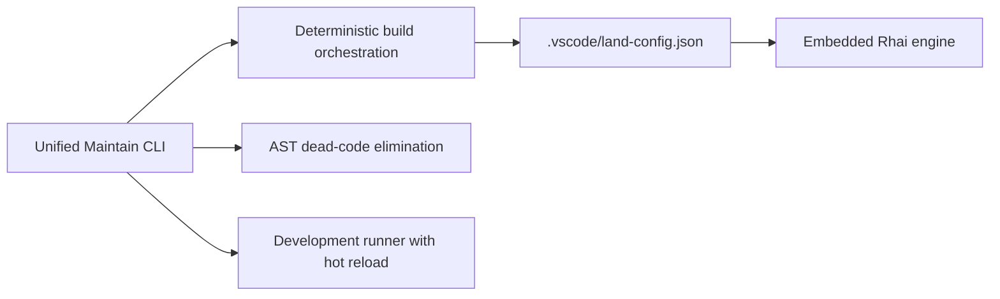
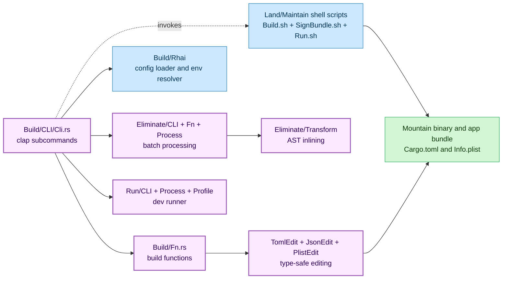
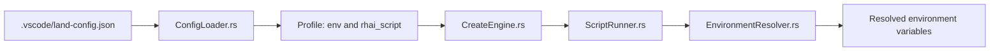
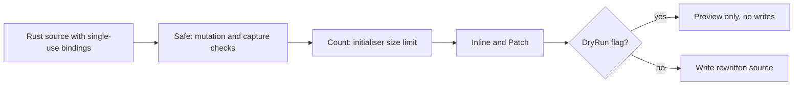

# **Maintain**

<table>
	<tr>
		<td>
			<a href="https://github.com/CodeEditorLand/Maintain" target="_blank">
				<picture>
					<source media="(prefers-color-scheme: dark)" srcset="https://img.shields.io/github/last-commit/CodeEditorLand/Maintain?label=Update&color=black&labelColor=black&logoColor=white&logoWidth=0" />
					<source media="(prefers-color-scheme: light)" srcset="https://img.shields.io/github/last-commit/CodeEditorLand/Maintain?label=Update&color=white&labelColor=white&logoColor=black&logoWidth=0" />
					
				</picture>
			</a>
			<br />
			<a href="https://github.com/CodeEditorLand/Maintain" target="_blank">
				<picture>
					<source media="(prefers-color-scheme: dark)" srcset="https://img.shields.io/github/issues/CodeEditorLand/Maintain?label=Issue&color=black&labelColor=black&logoColor=white&logoWidth=0" />
					<source media="(prefers-color-scheme: light)" srcset="https://img.shields.io/github/issues/CodeEditorLand/Maintain?label=Issue&color=white&labelColor=white&logoColor=black&logoWidth=0" />
					
				</picture>
			</a>
		</td>
		<td>
			<a href="https://github.com/CodeEditorLand/Maintain" target="_blank">
				<picture>
					<source media="(prefers-color-scheme: dark)" srcset="https://img.shields.io/github/stars/CodeEditorLand/Maintain?style=flat&label=Star&logo=github&color=black&labelColor=black&logoColor=white&logoWidth=0" />
					<source media="(prefers-color-scheme: light)" srcset="https://img.shields.io/github/stars/CodeEditorLand/Maintain?style=flat&label=Star&logo=github&color=white&labelColor=white&logoColor=black&logoWidth=0" />
					
				</picture>
			</a>
			<br />
			<a href="https://github.com/CodeEditorLand/Maintain" target="_blank">
				<picture>
					<source media="(prefers-color-scheme: dark)" srcset="https://img.shields.io/github/downloads/CodeEditorLand/Maintain/total?label=Download&color=black&labelColor=black&logoColor=white&logoWidth=0" />
					<source media="(prefers-color-scheme: light)" srcset="https://img.shields.io/github/downloads/CodeEditorLand/Maintain/total?label=Download&color=white&labelColor=white&logoColor=black&logoWidth=0" />
					
				</picture>
			</a>
		</td>
	</tr>
</table>

The Build System, Dead-Code Eliminator and Development Runner for Land

> Build pipelines that change behavior based on environment variables,
> implicit tool versions, or undeclared dependencies make debugging production
> issues impossible - the same commit produces different output on different
> machines. `Maintain` ensures deterministic builds: same commit, same output,
> guaranteed.

_"Deterministic builds and tooling for a reproducible ecosystem."_

[](https://github.com/CodeEditorLand/Maintain/tree/Current/LICENSE)
[](https://www.rust-lang.org/) [](https://crates.io/crates/Maintain)
[](https://www.rust-lang.org/) [](https://www.rust-lang.org/)
[](https://rhai.rs/) [](https://rhai.rs/)

**[`Rust` API Documentation](https://rust.documentation.maintain.editor.land/)**

---

## Overview 📋

`Maintain` is the `Rust`-based project maintenance toolkit for the **Land** Code Editor ecosystem. It provides three core capabilities: deterministic build orchestration driven by a single `.vscode/land-config.json` configuration file (loaded through an embedded `Rhai` engine), dead-code elimination through `AST`-level single-use variable inlining, and a development runner with hot-reload support.

Build pipelines that change behavior based on environment variables, implicit tool versions, or undeclared dependencies make debugging production issues impossible - the same commit produces different output on different machines. `Maintain` ensures deterministic builds: same commit, same output, guaranteed.



**`Maintain` is engineered to:**

1. **Orchestrate Deterministic Builds** - Provide a central build system for the entire Land ecosystem with named, config-driven build profiles (`.vscode/land-config.json`, resolved through an embedded `Rhai` engine), and type-safe configuration editing for `Cargo.toml`, `JSON5`, and `Info.plist` files.
2. **Eliminate Dead Code** - Analyse `Rust` source files via `syn` and inline `let` bindings that are used exactly once, are non-mutated, and have no closure-capture semantics - producing cleaner, more readable code without manual refactoring.
3. **Run with Hot-Reload** - Manage the development server lifecycle with profile-based configurations, environment variable resolution, and process management for rapid iteration.
4. **Provide a Unified CLI** - Deliver a single command-line interface with subcommands for `build`, `eliminate`, and `run` operations, making the toolkit accessible from shell scripts and CI pipelines alike.

---

## Key Features 🔐

**Config-Driven Build Profiles** - A single `.vscode/land-config.json` (`JSON5`, with comments and trailing commas) is the source of truth for:

| Selection | Values |
| --------- | ------ |
| Workbench | `Browser`, `Mountain`, `Electron`, `BrowserProxy` |
| Feature flags | Configured in the `features` section |
| Binary configuration | Configured in the `binary` section |
| Named profiles | Build and run profiles |

`Build/Rhai/ConfigLoader.rs` parses it; `Build/Rhai/EnvironmentResolver.rs` resolves environment variables dynamically against it.

**Embedded `Rhai` Engine** - `Build/Rhai/CreateEngine.rs` and `Build/Rhai/RegisterUtilityFunctions.rs` provide an in-process `Rhai` interpreter used internally by the config loader and environment resolver - there are no standalone `.rhai` script files to author or invoke.

**Deterministic Build Orchestration** - Central coordination of multi-stage builds across the Land ecosystem. The same commit produces the same output on every machine. Named profiles (resolved from `land-config.json`) and environment variable resolution ensure reproducibility.

**`AST`-Level Dead-Code Elimination** - Analyses `Rust` source files with `syn` and inlines single-use `let` bindings that meet strict safety criteria (non-mutated, no closure captures). Operates in dry-run mode for preview, supports glob-based file selection, and preserves comments and formatting with `prettyplease` reflow.

**Type-Safe Configuration Editing** - Compile-time checked editing of `Cargo.toml` (via `toml_edit`), `JSON5` configuration files (via `json5`), and `Info.plist` files (via `plist`). Supports:

- Version bumps
- Dependency updates
- Bundle identifier management

**Development Runner with Hot-Reload** - Profile-based dev server management with environment variable integration, process lifecycle management, and `Mountain` development mode support.

**Target Triple Resolution** - Automatic detection of the current platform target triple (`aarch64-apple-darwin`, `x86_64-unknown-linux-gnu`, etc.) for cross-platform build configuration.

**Unified CLI** - Single binary (`Maintain`) with subcommands for all operations:

| Operation | Purpose |
| --------- | ------- |
| `build` | Debug, release, or profile build |
| `eliminate` | Dead-code inline |
| `run` | Dev server, hot reload |

---

## Core Architecture Principles 🏗️

| Principle | Description | Key Components |
| --------- | ----------- | -------------- |
| **Determinism** | Same commit, same output on every machine. Environment variables are explicit and declared, not implicit. | `Build/Constant`, `Build/Definition`, `Build/Fn` |
| **Scriptability** | Embedded `Rhai` scripting with full environment access for custom build automation, not hard-coded logic. | `Build/Rhai/ScriptRunner`, `Build/Rhai/ConfigLoader`, `Build/Rhai/EnvironmentResolver` |
| **Type Safety** | Compile-time checked configuration with `toml_edit`, `json5`, and `plist`. No runtime string manipulation of build configs. | `Build/TomlEdit`, `Build/JsonEdit`, `Build/PlistEdit` |
| **Safe Code Transformation** | `AST`-level inlining with strict safety checks - no mutation, no closure captures, single-use only. Dry-run mode for preview. | `Eliminate/Transform/Safe`, `Eliminate/Transform/Inline`, `Eliminate/Transform/Collect` |
| **Modularity** | Separate CLI, build orchestration, eliminate engine, and run-mode logic. Each module compiles and tests independently. | `Source/Build/*`, `Source/Eliminate/*`, `Source/Run/*` |

---

## System Architecture 🗺️



**Operation paths:**

| Path | Module | Use Case |
| ---- | ------ | -------- |
| `Maintain build` | `Build/CLI` -> `Build/Rhai/ConfigLoader` -> `Build/Fn` | Orchestrate deterministic builds from `.vscode/land-config.json` profiles |
| `Maintain eliminate` | `Eliminate/CLI` -> `Eliminate/Fn` -> `Transform` pipeline | Inline single-use `let` bindings across `Rust` source files |
| `Maintain run` | `Run/CLI` -> `Run/Process` -> `Run/Profile` | Launch dev server with hot-reload and profile config |
| `Build/Fn` -> `TomlEdit` | `toml_edit` crate | Edit `Cargo.toml` with type-safe version bumps and dependency updates |
| `Build/Fn` -> `JsonEdit` | `json5` crate | Edit `JSON5` configuration files (e.g. `land-config.json`) |
| `Build/Fn` -> `PlistEdit` | `plist` crate | Edit `Info.plist` and `Entitlements.plist` |

---

## Configuration ⚙️

`.vscode/land-config.json` is parsed as `JSON5` into a typed `LandConfig` structure by `Build/Rhai/ConfigLoader.rs`. The structure carries:

| Field | Content |
| ----- | ------- |
| `version` | Configuration version |
| `workbench` | Workbench configuration |
| `features` | Feature flags configuration |
| `binary` | Binary configuration |
| `profiles` | Build profiles (debug, production, release, etc.) |
| `templates` | Default template values |
| `env_prefixes` | Environment variable prefixes per crate |
| `build_commands` | Build command templates |
| `environment_variables` | Environment variable inventory |
| `cli` | CLI configuration (default profile, aliases, log format, colors, progress, dry-run default) |



`Build/Rhai/EnvironmentResolver.rs` merges environment variables from six sources, in order: template defaults, profile-specific static variables, workbench environment variables, feature flag variables, `Rhai` script output, and the current process environment. It supports `${VAR}` expansion and applies per-crate prefixes.

`Build/Rhai/CreateEngine.rs` sets maximum expression depth and maximum operations to 0 (unlimited) and enables variable shadowing. `Build/Rhai/RegisterUtilityFunctions.rs` registers `get_os_type`, `get_arch`, `get_family`, `get_env`, `path_exists`, `timestamp`, and `print`.

---

## Key Components 🧩

| Component | Path | Description |
| --------- | ---- | ----------- |
| Library (Entry) | `Source/Library.rs` | Main entry point and module declarations |
| Build CLI | `Source/Build/CLI/Cli.rs` | Command-line interface with `clap` (subcommands: build, list-profiles, show-profile, validate-profile, resolve) |
| Build Functions | `Source/Build/Fn.rs` | Build orchestration functions |
| Build Constants | `Source/Build/Constant.rs` | Build system constants and env var names |
| Build Definitions | `Source/Build/Definition.rs` | Build type definitions and data structures |
| TOML Editor | `Source/Build/TomlEdit.rs` | Type-safe `Cargo.toml` editing via `toml_edit` |
| JSON5 Editor | `Source/Build/JsonEdit.rs` | `JSON5` configuration editing via `json5` |
| Plist Editor | `Source/Build/PlistEdit.rs` | `Info.plist` and entitlements editing via `plist` |
| Pascalize | `Source/Build/Pascalize.rs` | String conversion utilities (snake_case to PascalCase) |
| WordsFromPascal | `Source/Build/WordsFromPascal.rs` | Split PascalCase identifiers into words |
| Target Triple | `Source/Build/GetTauriTargetTriple.rs` | Target triple resolution for cross-platform builds |
| Architecture | `Source/Architecture.rs` | Platform detection (macOS, Linux, Windows, arch) |
| `Rhai` Script Runner | `Source/Build/Rhai/ScriptRunner.rs` | Executes `Rhai` expressions embedded in the config-resolution pipeline |
| `Rhai` Config Loader | `Source/Build/Rhai/ConfigLoader.rs` | Parses `.vscode/land-config.json` (`JSON5`) into typed profile/workbench data |
| `Rhai` Env Resolver | `Source/Build/Rhai/EnvironmentResolver.rs` | Dynamic environment variable resolution against loaded config |
| `Rhai` Engine Factory | `Source/Build/Rhai/CreateEngine.rs` | Constructs and configures the embedded `Rhai` interpreter |
| Eliminate CLI | `Source/Eliminate/CLI.rs` | CLI for batch dead-code elimination |
| Eliminate Fn | `Source/Eliminate/Fn.rs` | Top-level entry point for elimination |
| Eliminate Process | `Source/Eliminate/Process.rs` | File discovery and orchestration |
| Eliminate Definition | `Source/Eliminate/Definition.rs` | Data structures and options (MaxSize, DryRun, etc.) |
| Eliminate Error | `Source/Eliminate/Error.rs` | Error types for the elimination pipeline |
| Eliminate Logger | `Source/Eliminate/Logger.rs` | Colored logging initialization |
| Transform Safe | `Source/Eliminate/Transform/Safe.rs` | Safety checks (no mutation, no closure captures) |
| Transform Inline | `Source/Eliminate/Transform/Inline/Eliminator.rs` | `AST`-level `let` binding inlining |
| Transform Collect | `Source/Eliminate/Transform/Collect.rs` | Usage-site collection and counting |
| Transform Count | `Source/Eliminate/Transform/Count.rs` | `AST` node counting for initialiser size limits |
| Transform Patch | `Source/Eliminate/Transform/Patch.rs` | Precise file rewrites (comment-preserving) |
| Run CLI | `Source/Run/CLI/Cli.rs` | CLI for profile-based development runs |
| Run Process | `Source/Run/Process.rs` | Process management and lifecycle |
| Run Profile | `Source/Run/Profile.rs` | Performance profiling and profile resolution |
| Run Environment | `Source/Run/Environment.rs` | Environment variable management for dev runs |
| Run Fn | `Source/Run/Fn.rs` | Main entry point for run operations |
| Run Definition | `Source/Run/Definition.rs` | Type definitions for run module |
| Run Error | `Source/Run/Error.rs` | Error types for run operations |
| Run Logger | `Source/Run/Logger.rs` | Logging utilities for run module |

---

## Project Structure 🏗️

```
Element/Maintain/
|-- Cargo.toml                       # Package manifest (bin + lib + tests)
|-- build.rs                         # Build script
|-- Source/
|   |-- main.rs                      # Binary entry point (bin: Maintain)
|   |-- Library.rs                   # Library root (exports Build, Eliminate, Run)
|   |-- Architecture.rs              # Platform detection and target triples
|   |-- Build/                       # Build orchestration and scripting
|   |   |-- mod.rs                   # Module re-exports
|   |   |-- CLI/                     # clap CLI (config-driven)
|   |   |   |-- Cli.rs               #   build, list-profiles, show-profile,
|   |   |   |-- Commands.rs          #   validate-profile, resolve
|   |   |   |-- GetAllProfiles.rs
|   |   |   `-- OutputFormat.rs
|   |   |-- Constant.rs              # File paths, env var names, delimiters
|   |   |-- Definition.rs            # Build type definitions
|   |   |-- Error.rs                 # Build error types
|   |   |-- Fn.rs                    # Build orchestration functions
|   |   |-- GetTauriTargetTriple.rs  # Target triple resolution
|   |   |-- JsonEdit.rs              # JSON5 config editing
|   |   |-- Logger.rs                # Build logging
|   |   |-- Pascalize.rs             # snake_case to PascalCase
|   |   |-- PlistEdit.rs             # Info.plist / Entitlements.plist editing
|   |   |-- Process/                 # Build process orchestration
|   |   |   |-- Process.rs
|   |   |   `-- BuildPlistEnvironment.rs
|   |   |-- TomlEdit.rs              # Cargo.toml type-safe editing
|   |   |-- WordsFromPascal.rs       # Split PascalCase into words
|   |   `-- Rhai/                    # Embedded Rhai engine + config loader
|   |       |-- mod.rs
|   |       |-- ConfigLoader.rs      # Parses .vscode/land-config.json
|   |       |-- CreateEngine.rs      # Rhai engine construction
|   |       |-- EnvironmentResolver.rs  # Dynamic env var resolution
|   |       |-- RegisterUtilityFunctions.rs  # Rhai helper functions
|   |       `-- ScriptRunner.rs      # Rhai script execution
|   |-- Eliminate/                   # Dead-code elimination (AST-level inlining)
|   |   |-- mod.rs                   # Module re-exports
|   |   |-- CLI.rs                   # CLI (--path, --glob, --dry-run)
|   |   |-- Constant.rs              # Defaults (MaxSize, DefaultGlob)
|   |   |-- Definition.rs            # Options, Stats structures
|   |   |-- Error.rs                 # Elimination error types
|   |   |-- Fn.rs                    # Top-level entry point
|   |   |-- Logger.rs                # Colored logging
|   |   |-- Process.rs               # File discovery and orchestration
|   |   `-- Transform/               # AST transformation pipeline
|   |       |-- mod.rs               # Pipeline orchestration
|   |       |-- Collect.rs           # Usage-site collection
|   |       |-- CollectBlockPatches.rs
|   |       |-- CollectInnerBlockPatches.rs
|   |       |-- Count.rs             # AST node counting
|   |       |-- Inline/              # Inline single-use bindings
|   |       |   |-- Eliminator.rs
|   |       |   |-- Substitutor.rs
|   |       |   `-- Tests.rs
|   |       |-- Patch.rs             # Precise file rewrites
|   |       |-- PreservePass.rs
|   |       |-- Run.rs
|   |       |-- RunPreserve.rs
|   |       |-- Safe.rs              # Safety checks (mutation, captures)
|   |       |-- StmtNestedBlock.rs
|   |       |-- StmtTokensMatch.rs
|   |       |-- StmtToText.rs
|   |       |-- TryBlockPreserve.rs
|   |       |-- TryItemPreserve.rs
|   |       `-- TryPatchSource.rs
|   `-- Run/                         # Development runner
|       |-- mod.rs                   # Module re-exports
|       |-- CLI/                     # CLI (config-driven)
|       |   |-- Cli.rs               #   run, list-profiles, show-profile,
|       |   |-- Commands.rs          #   validate-profile, resolve
|       |   `-- OutputFormat.rs
|       |-- Constant.rs              # Run module constants
|       |-- Definition.rs            # Type definitions
|       |-- Environment.rs           # Environment variable management
|       |-- Error.rs                 # Error types
|       |-- Fn.rs                    # Main entry point
|       |-- Logger.rs                # Logging utilities
|       |-- Process.rs               # Process management
|       `-- Profile.rs               # Profile resolution
|-- tests/
|   |-- Eliminate.rs                 # Top-level test declarations
|   |-- test_rhai_config.rs          # Rhai config loading tests
|   `-- Eliminate/
|       |-- Syntactic.rs             # Unit tests for transform pipeline
|       |-- Integration.rs           # Integration test runner
|       `-- Integration/             # Integration test cases
|           |-- BinaryParens.rs
|           |-- BlockIntoIfLet.rs
|           |-- BorrowInline.rs
|           |-- CastExpr.rs
|           |-- Chain.rs
|           |-- ClosureCaptureKept.rs
|           |-- ClosureLocal.rs
|           |-- Idempotent.rs
|           |-- IfGuard.rs
|           |-- LoopUri.rs
|           |-- MatchScrutinee.rs
|           |-- MtimeChain.rs
|           |-- MultiUseKept.rs
|           |-- NegatedBool.rs
|           |-- NestedScope.rs
|           |-- QuestionMark.rs
|           |-- Shadow.rs
|           |-- Simple.rs
|           |-- StructLiteral.rs
|           `-- TypeAnnotation.rs
|-- examples/
|   `-- test_rhai_config.rs          # Rhai configuration example
`-- Documentation/
    |-- GitHub/
    |   `-- DeepDive.md              # Deep-dive technical documentation
    `-- Rust/
        `-- doc/                     # Cargo doc output
```

---

## In the Land Project 🗺️

**`Maintain`** serves as the project maintenance toolkit for the entire Land Code Editor ecosystem, providing three complementary capabilities that span the development lifecycle:

| Capability | Module | Role in Land |
| ---------- | ------ | ------------ |
| **Build Orchestration** | `Source/Build` | Compiles all Land elements (`Mountain`, `Grove`, `Cocoon`, etc.) with deterministic, profile-driven builds resolved from `.vscode/land-config.json`, plus type-safe config editing |
| **Dead-Code Elimination** | `Source/Eliminate` | Analyses and cleans up `Rust` source across all elements by inlining single-use `let` bindings - reducing manual refactoring burden |
| **Development Runner** | `Source/Run` | Launches `Mountain` in development mode with hot-reload, profile-based configuration, and environment variable integration |

`Maintain` orchestrates builds across all Land elements. Its `build` CLI subcommand resolves a named profile from `.vscode/land-config.json`; the profile carries:

- `workbench`
- `features`
- `environment variables`

The sibling shell scripts under `Land/Maintain/` (`Debug/Build.sh`, `Release/Build.sh`, `Script/SignBundle.sh`) compile and code-sign the `Mountain` binary. The embedded `Rhai` engine backs the config loader and environment resolver - it is not a user-facing scripting surface. Configuration editors modify `Cargo.toml` (version bumps, dependency updates), `JSON5` configs, and `Info.plist`/`Entitlements.plist` files. `Maintain` resolves environment variables dynamically for build-time configuration.

The `Eliminate` module operates independently on any `Rust` source tree, providing `AST`-level dead-code removal with a dry-run mode for preview. It is designed to be idempotent - running it twice produces the same output.

---

## Getting Started 🚀

### Prerequisites 📦

- **`Rust`** 1.95.0 or later (edition 2024)

### Installation 📦

To add `Maintain` as a dependency:

```toml
[dependencies]
Maintain = { git = "https://github.com/CodeEditorLand/Maintain.git", branch = "Current" }
```

Or install the CLI globally:

```sh
cargo install Maintain
```

### Usage 💻

At the Land monorepo root, `Maintain` is invoked through shell scripts that live in `Land/Maintain/` (outside this crate) and read `.vscode/land-config.json`:

```sh
# Debug build (profile-aware, auto-signs the .app afterward)
sh Maintain/Debug/Build.sh --profile debug-electron

# Development runner with hot reload
sh Maintain/Debug/Run.sh

# Release build
sh Maintain/Release/Build.sh

# Ad-hoc re-sign of an already-built .app
BundleLevel=debug sh Maintain/Script/SignBundle.sh
```

As a binary with subcommands (config-driven build/run, resolved from `land-config.json`):

```sh
# Build operations
cargo run --bin Maintain -- build --profile debug-mountain
cargo run --bin Maintain -- list-profiles --verbose
cargo run --bin Maintain -- show-profile debug-mountain
cargo run --bin Maintain -- resolve --profile debug-mountain --format table

# Dead-code elimination
cargo run --bin Maintain -- eliminate --path ./Source --glob "**/*.rs"
cargo run --bin Maintain -- eliminate --path ./Source/Foo.rs --dry-run

# Development runner
cargo run --bin Maintain -- run --profile debug-mountain --hot-reload
```

### Key Dependencies 🧩

| Crate | Purpose |
| ----- | ------- |
| `rhai` | Embedded scripting engine for build automation |
| `clap` | CLI argument parsing with subcommands |
| `syn` | `Rust` `AST` parsing (full syntax, visitor, fold) |
| `toml_edit` | Type-safe `TOML` parsing and editing |
| `json5` | `JSON5` configuration support |
| `plist` | `Info.plist` and entitlements editing |
| `prettyplease` | `AST` to source code pretty-printing |
| `proc-macro2` / `quote` | Token stream manipulation for code generation |
| `chrono` | Date/time handling for logging |
| `colored` | Colored terminal output |
| `log` / `env_logger` | Logging framework |

### As a Library 📖

```rust
use Maintain::{Build, Eliminate, Run};

// Build CLI (config-driven, reads .vscode/land-config.json)
let Cli = Build::CLI::Cli::Cli::try_parse_from(["Maintain", "build", "--profile", "debug-mountain"])?;
Cli.execute()?;

// Dead-code elimination
let Options = Eliminate::Definition::Options {
	MaxSize:Eliminate::Constant::DefaultMaxSize,
	InlineComments:false,
	DryRun:true,
};
Eliminate::Process::Process(std::path::Path::new("./Source"), "**/*.rs", &Options)?;

// Development runner (config-driven, reads .vscode/land-config.json)
let Cli = Run::CLI::Cli::Cli::try_parse_from(["Maintain", "run", "--profile", "debug-mountain"])?;
Cli.execute()?;
```

---

## Security 🛡️

`Maintain` enforces safety at multiple layers:

| Layer | Mechanism |
| ----- | --------- |
| **Deterministic builds** | Explicit environment variable declarations - no implicit tool versions or undeclared dependencies |
| **AST transformation** | `Eliminate/Transform/Safe` enforces strict safety checks: no mutation, no closure captures, single-use only before inlining |
| **Dry-run mode** | `--dry-run` flag previews all elimination changes without writing files |
| **Type safety** | Compile-time checked configuration editing via `toml_edit`, `json5`, and `plist` |
| **CI reproducibility** | Same commit produces the same output on every machine - guaranteed by design |



---

## Compatibility 🔌

`Maintain` is designed to be compatible with:

| Target | Integration |
| ------ | ----------- |
| **`Mountain`** | Builds and code-signs the `Mountain` native desktop shell binary |
| **All Land Elements** | `Eliminate` operates on any `Rust` source tree in the Land Code Editor monorepo |
| **CI Pipelines** | Unified CLI with subcommands for build, eliminate, and run - suitable for GitHub Actions and other CI systems |
| **Shell Scripts** | Invoked by the sibling shell scripts under `Land/Maintain/` for platform-specific build steps (code signing, bundling) |
| **JSON5 Ecosystem** | Reads standard `.vscode/land-config.json` (`JSON5`) for profile, workbench, and feature configuration |

---

## API Reference 📖

- **[`Rust` API Documentation](https://rust.documentation.maintain.editor.land/)**

---

## License 📖

This project is released into the public domain under the **Creative Commons CC0 Universal** license. You are free to use, modify, distribute, and build upon this work for any purpose, without any restrictions. For the full legal text, see the [`LICENSE`](https://github.com/CodeEditorLand/Maintain/tree/Current/LICENSE) file.

---

## Changelog 📖

Stay updated with our progress! See [`CHANGELOG.md`](https://github.com/CodeEditorLand/Maintain/tree/Current/CHANGELOG.md) for a history of changes.

---

## Funding & Acknowledgements 📖

**Land** is proud to be an open-source endeavor. Our journey is significantly supported by the organizations and projects that believe in the future of open-source software.

This project is funded through [NGI0 Commons Fund](https://NLnet.NL/commonsfund), a fund established by [NLnet](https://NLnet.NL) with financial support from the European Commission's [Next Generation Internet](https://ngi.eu) program. Learn more at the [NLnet project page](https://NLnet.NL/project/Land).

<table>
	<thead>
		<tr>
			<th align="left">
				<strong>
					Land
				</strong>
			</th>
			<th align="left">
				<strong>
					PlayForm
				</strong>
			</th>
			<th align="left">
				<strong>
					NLnet
				</strong>
			</th>
			<th align="left">
				<strong>
					NGI0 Commons Fund
				</strong>
			</th>
		</tr>
	</thead>
	<tbody>
		<tr>
			<td align="left" valign="middle">
				<a href="https://editor.land">
					
				</a>
			</td>
			<td align="left" valign="middle">
				<a href="https://PlayForm.Cloud">
					
				</a>
			</td>
			<td align="left" valign="middle">
				<a href="https://NLnet.NL">
					
				</a>
			</td>
			<td align="left" valign="middle">
				<a href="https://NLnet.NL/commonsfund">
					
				</a>
			</td>
		</tr>
	</tbody>
</table>

---

## Related Documentation 📖

- [Architecture Overview](https://Editor.Land/Doc/architecture) - Land system architecture
- [Why `Rust`](https://Editor.Land/Doc/why-rust) - Why `Rust` for build tooling
- [`Mountain`](https://github.com/CodeEditorLand/Mountain) - Native desktop shell
- [`Grove`](https://github.com/CodeEditorLand/Grove) - `Rust`/`WASM` extension host
- [`Rest`](https://github.com/CodeEditorLand/Rest) - HTTP/REST API Server for Land
- [`Output`](https://github.com/CodeEditorLand/Output) - Build Output and Artifact Management for Land

---

**Project Maintainers:** Source Open
([Source/Open@Editor.Land](mailto:Source/Open@Editor.Land)) |
[GitHub Repository](https://github.com/CodeEditorLand/Maintain) |
[Report an Issue](https://github.com/CodeEditorLand/Maintain/issues)
